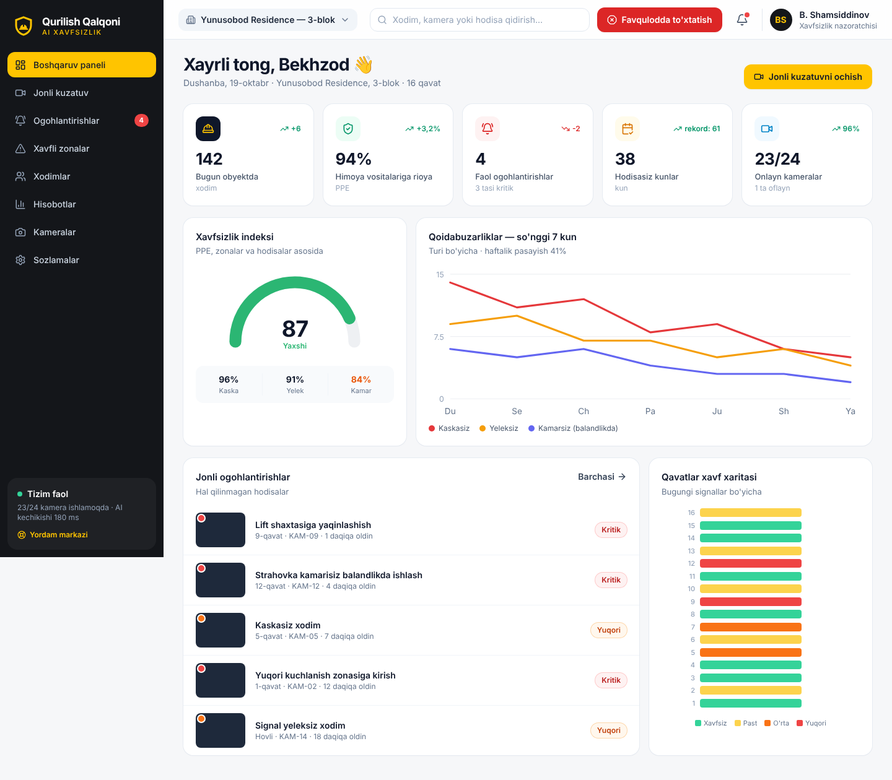

# 🛡️ Qurilish Qalqoni

🌐 **Ishlayotgan platforma:** https://qurilish-qalqoni.vercel.app  ·  📁 Kod: [`platform/`](platform) (veb-platforma), [`edge/`](edge) (obyektdagi qurilma agenti), [`web/`](web) (dizayn prototipi)

**Kuzatuv kameralari va sun'iy intellekt yordamida qurilish obyektlarida jarohat va o'lim holatlarining oldini oluvchi platforma.**

Tizim quruvchi va xodimlarning maxsus uniforma hamda himoya vositalari (kaska, signal yelek, strahovka kamari) bilan jihozlanganligini real vaqtda tekshiradi. Belgilangan xavfli zonaga yaqinlashgan odamga — joyning o'zida sirena va ovozli xabar orqali, qurilish kompaniyasi nazoratchilariga esa Telegram, SMS va dastur orqali ogohlantirish beradi.

---

## 1. Muammo

Qurilishdagi og'ir baxtsiz hodisalarning asosiy qismi ehtiyotsizlik va e'tiborsizlik tufayli sodir bo'ladi: balandlikdan yiqilish (lift va zina shaxtalari, to'siqsiz derazalar, ochiq qirralar), elektr toki urishi, kran yuki ostida qolish. Bitta nazoratchi 16 qavatli obyektning hamma joyini bir vaqtda ko'ra olmaydi — kamera va AI esa ko'ra oladi.

## 2. Asosiy funksiyalar (asl g'oya)

| # | Funksiya | Tavsif |
|---|----------|--------|
| 1 | **PPE nazorati** | Kaska, signal yelek, strahovka kamari bor-yo'qligini har bir kadrda aniqlash |
| 2 | **Xavfli zonalar** | Lift/zina shaxtalari, to'siqsiz derazalar, yuqori kuchlanish joylari va h.k. kamera kadrida belgilanadi |
| 3 | **Ikki tomonlama signal** | Zonaga yaqinlashgan odamning o'ziga (joyida) + nazoratchilarga (masofadan) |

## 3. Kiritilgan takliflar va bartaraf etilgan kamchiliklar

Asl tavsifni tahlil qilib, quyidagi bo'shliqlar topildi va yechimlar taklif qilindi:

### 3.1. Zonalarni dasturchi emas, nazoratchining o'zi belgilashi kerak
**Kamchilik:** tavsifda zonalarni *dasturchilar* belgilaydi. Qurilish har kuni o'zgaradi — bugun ochiq bo'lgan shaxta ertaga yopiladi, yangi qavatda yangi ochiqlik paydo bo'ladi. Har safar dasturchi chaqirish sekin va qimmat.
**Yechim:** **Xavfli zonalar muharriri** — prorab yoki xavfsizlik muhandisi kamera kadri ustida sichqoncha/barmoq bilan zonani 1 daqiqada chizadi, turini tanlaydi (lift shaxtasi, zina, ochiq qirra, yuqori kuchlanish, kran radiusi, chuqur), ogohlantirish masofasini va ruxsat etilgan kasblarni belgilaydi.

### 3.2. Ruxsat etilgan xodimlar uchun yolg'on signallar
**Kamchilik:** elektrik elektr shchitiga, liftchi lift shaxtasiga kirishi kerak — tizim ularni har safar "xavf" deb belgilasa, nazoratchilar signallarga e'tibor bermay qo'yadi ("signal charchog'i").
**Yechim:** har bir zonada **ruxsat etilgan rollar** ro'yxati + QR-beyj/turniket integratsiyasi; ruxsatli xodimda PPE to'liq bo'lsa signal berilmaydi.

### 3.3. Eskalatsiya zanjiri
**Kamchilik:** signal faqat bir marta yuborilsa va hech kim javob bermasa, hodisa e'tiborsiz qoladi.
**Yechim:** avtomatik zanjir: **0 s** — joyida sirena va ovozli xabar (o'zbek/rus) → **30 s** — prorabga Telegram xabar + dalil kadri → **2 daq** — tasdiqlanmasa xavfsizlik bo'limi boshlig'iga qo'ng'iroq/SMS.

### 3.4. Strahovka kamari va balandlikda ishlash
**Kamchilik:** tavsifda faqat "uniforma va jihozlar" deyilgan. O'limga eng ko'p olib keladigan omil — balandlikdan yiqilish.
**Yechim:** ochiq qirra va balandlik zonalarida **strahovka kamari** alohida tekshiriladi va kritik daraja beriladi.

### 3.5. Qo'shimcha AI imkoniyatlari
- **Qulagan odamni aniqlash** — xodim N soniyadan ortiq harakatsiz yotsa, darhol signal.
- **Kran yuki ostidagi zona** — kran ishlayotganda radius ichidagi odamlar.
- **Tungi qo'riqlash rejimi** — 20:00 dan keyin obyektdagi har qanday harakat (o'g'irlikdan himoya — qo'shimcha daromad manbai).
- **Obyektdagi odamlar soni** — favqulodda evakuatsiyada kim qolganini bilish.

### 3.6. Internet uzilishi
**Kamchilik:** video bulutga yuborilsa, obyektdagi internet uzilganda tizim ishlamay qoladi, kechikish esa 2–5 soniyagacha yetadi.
**Yechim:** **Edge AI** — video obyektning o'zida (NVIDIA Jetson Orin) qayta ishlanadi, kechikish ~200 ms. Sirena internet bo'lmasa ham ishlaydi. Bulutga faqat hodisa kliplari va statistika yuboriladi.

### 3.7. Mavjud kameralardan foydalanish
Ko'p obyektlarda allaqachon IP-kameralar bor. Tizim **RTSP/ONVIF** orqali mavjud kameralarga ulanadi — mijoz uchun kirish narxi keskin pasayadi.

### 3.8. Maxfiylik va qonunchilik
**Kamchilik:** xodimlarni doimiy videoga olish shaxsga doir ma'lumotlar masalasini keltirib chiqaradi.
**Yechim:** yuzlar sukut bo'yicha xiralashtiriladi, oddiy video 7–30 kun, faqat hodisa kliplari uzoqroq saqlanadi, kirish ikki bosqichli autentifikatsiya bilan. Ishga tushirishdan oldin O'zbekistonning "Shaxsga doir ma'lumotlar to'g'risida"gi qonuni bo'yicha yurist bilan maslahatlashish va xodimlardan yozma rozilik olish tavsiya etiladi.

### 3.9. Yolg'on signallardan o'rganish
Nazoratchi "Yolg'on signal" tugmasini bossa, kadr belgilanadi va AI modelini qayta o'qitishda ishlatiladi — tizim har oy aniqroq bo'lib boradi.

### 3.10. Hisobot va biznes qiymat
- Pudratchi/brigadalar bo'yicha **xavfsizlik reytingi** (bosh pudratchi uchun dalil).
- **Eng xavfli soatlar** tahlili (odatda tushlikdan keyin va ish oxirida).
- Davlat inspeksiyasi va sug'urta kompaniyalari uchun **PDF eksport** — sug'urta badalini kamaytirish argumenti.

## 4. Interfeys (UI/UX)

🎨 **Magic Patterns dizayni:** https://www.magicpatterns.com/c/2lddtdw8eearq6nqbbgwth

8 ta ekran, to'liq o'zbek tilida, kompyuter, planshet va telefonga moslashgan:

| Ekran | Vazifasi |
|-------|----------|
| **Boshqaruv paneli** | KPI'lar, Xavfsizlik indeksi, 7 kunlik qoidabuzarliklar grafigi, jonli signallar, qavatlar xavf xaritasi |
| **Jonli kuzatuv** | Kameralar to'ri AI qatlamlari bilan (odam ramkalari, Kaska/Yelek/Kamar belgilari, xavfli zona), bir bosishda ovozli ogohlantirish |
| **Ogohlantirishlar** | Daraja va holat bo'yicha filtr, dalil kadri, eskalatsiya zanjiri, "Men olaman" / "Hal qilindi" |
| **Xavfli zonalar** | Kadr ustida interaktiv zona chizish muharriri, masofa, ruxsatlar, signal turlari |
| **Xodimlar** | PPE rioyasi foizi, buzilishlar, yo'riqnoma muddati |
| **Hisobotlar** | Brigadalar reytingi, buzilish turlari, xavfli soatlar, PDF/inspeksiya eksporti |
| **Kameralar** | Kamera va edge-qurilmalar holati (yuklama, harorat, xotira) |
| **Sozlamalar** | Telegram/SMS/sirena, ovozli xabar tili, maxfiylik, integratsiyalar |

Dizayn tamoyillari: texnikaga uncha qiziqmaydigan prorab ham tushunadigan katta yozuvlar, aniq ranglar (🟢 xavfsiz · 🟠 diqqat · 🔴 kritik), har bir harakat 1–2 bosishda. Brend rangi — xavfsizlik sarig'i `#FFC400` va grafit `#14161A`.



### Ishga tushirish

```bash
cd web
npm install
npm run dev      # http://localhost:5173
npm run build    # production build
```

Hozircha interfeys demo ma'lumotlar bilan ishlaydi (`web/src/data/mock.ts`).

## 5. Texnik arxitektura (taklif)

```
[IP-kameralar] --RTSP--> [Edge server: NVIDIA Jetson Orin]
                              │  YOLO (odam + PPE detektsiyasi)
                              │  Kuzatish (ByteTrack) + zona geometriyasi
                              │  Qoidalar mexanizmi (masofa, rol, vaqt)
                              ├──> Joyidagi sirena / karnay (lokal, internetsiz)
                              └──> [Bulut backend] --> Veb-panel / Telegram bot / SMS
                                        │
                                   PostgreSQL + hodisa kliplari (S3)
```

| Qatlam | Texnologiya |
|--------|-------------|
| AI model | YOLOv8/YOLO11, kaska/yelek/kamar uchun mahalliy obyektlarda yig'ilgan rasmlar bilan qayta o'qitilgan |
| Edge | NVIDIA Jetson Orin (6–8 kamera / qurilma), DeepStream |
| Backend | Python (FastAPI) yoki Node.js, PostgreSQL, Redis, WebSocket |
| Frontend | React + TypeScript + Tailwind (ushbu repozitoriydagi `web/`) |
| Bildirishnoma | Telegram Bot API, SMS shlyuz (Eskiz.uz / Play Mobile), IP-karnaylar |

## 6. Yo'l xaritasi

1. **MVP (1–2 oy):** kaska + yelek detektsiyasi, 1 obyektda 4–6 kamera, Telegram signal, veb-panel.
2. **Pilot (3–4 oy):** zona muharriri, strahovka kamari, sirena/karnay, eskalatsiya, yolg'on signal bilan qayta o'qitish.
3. **Tijoriy versiya (5–6 oy):** ko'p obyektli boshqaruv, hisobotlar va eksport, turniket integratsiyasi, mobil ilova.

**Biznes modeli:** kamera boshiga oylik obuna (SaaS) + edge-qurilma o'rnatish xizmati. Asosiy mijozlar — yirik quruvchi kompaniyalar va bosh pudratchilar.

## 7. Muvaffaqiyat ko'rsatkichlari

- PPE rioyasi: 3 oyda ≥ 95%
- Xavfli zonaga kirishlar: 3 oyda −50%
- Signalga o'rtacha javob vaqti: < 2 daqiqa
- Yolg'on signallar: < 5%

---

© United IT Clubs
